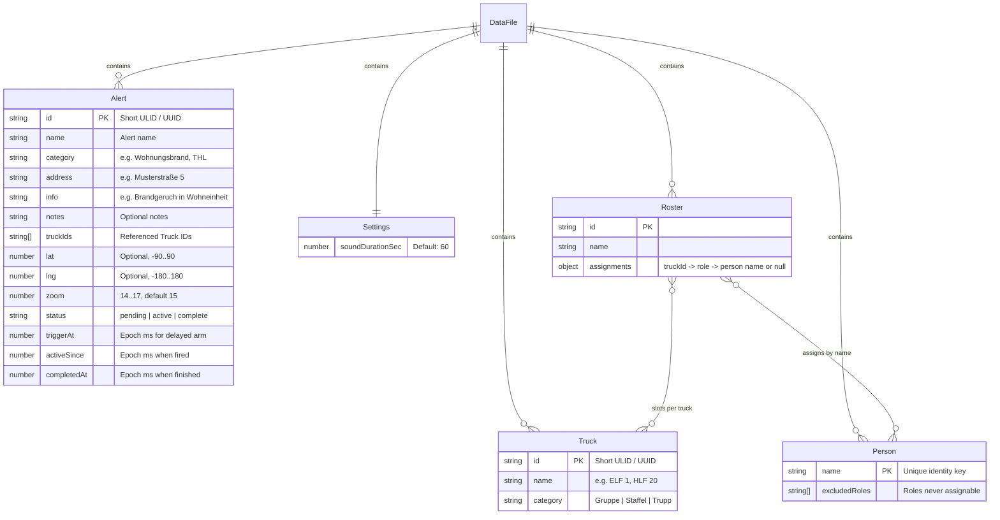
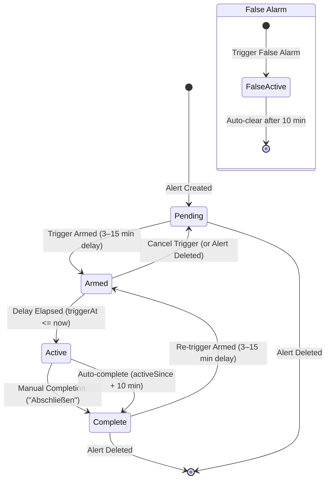
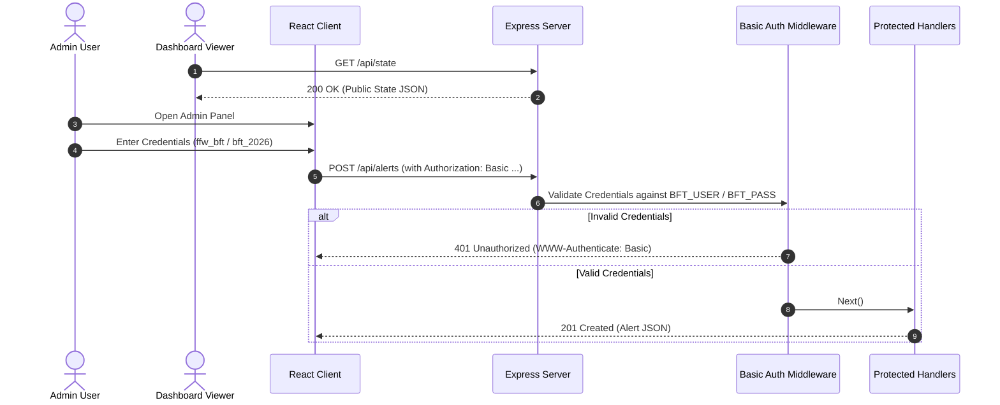
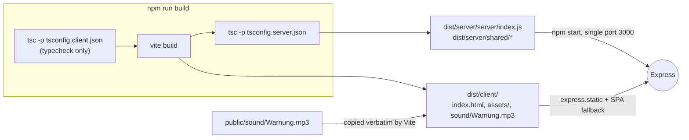

# Firealarm Simulator — Architecture Overview

## 1. System Overview

The Firealarm Simulator is a full-stack Node.js web application designed to
simulate a fire station alarm system (Einsatzmonitor) for training and fire
drills. It comprises an Express backend serving a REST JSON API and a
single-page React frontend built with Material UI (MUI).

```mermaid
graph TD
    subgraph Client["Browser Client (Desktop & Mobile)"]
        Dashboard["Public Dashboard (Einsatzmonitor)<br/>Polls /api/state every 2s<br/>Audio Player (Ton toggle)"]
        AdminUI["Admin Interface<br/>HTTP Basic Auth<br/>Truck & Alert Management<br/>Trigger & Sound Settings"]
    end

    subgraph Server["Node.js / Express Server"]
        StaticServe["Static SPA Server<br/>Vite Build Output + Assets"]
        AuthMiddleware["Basic Auth Middleware<br/>BFT_USER / BFT_PASS"]
        PublicAPI["Public API (/api/state)"]
        AdminAPI["Admin API (/api/trucks, /api/alerts, etc.)"]
        StateEngine["State & Lifecycle Engine<br/>Tick Loop (1s Interval)"]
        StorageEngine["Atomic File Persistence<br/>data.json (temp + rename)"]
    end

    subgraph Persistence["Storage & Assets"]
        DataJSON[("data.json")]
        SoundFile[("Warnung.mp3")]
    end

    Dashboard -->|GET /api/state (polling)| PublicAPI
    AdminUI -->|REST with Basic Auth| AuthMiddleware
    AuthMiddleware --> AdminAPI
    PublicAPI --> StateEngine
    AdminAPI --> StateEngine
    StateEngine --> StorageEngine
    StorageEngine --> DataJSON
    StaticServe --> SoundFile
```

---

## 2. Component Architecture

### 2.1 Backend (Express + TypeScript)

- **Entry Point (`src/server/index.ts`)**: Initializes configuration, starts the
  tick loop, loads persisted state, mounts routes, and listens on `PORT`
  (default: 3000).
- **Persistence Layer (`src/server/storage.ts`)**: Manages reading and atomic
  writing of `data.json`. On initial startup, if `data.json` is missing, it
  creates the file initialized with seed data (5 trucks, 2 pending alerts,
  default settings). `load()` validates structure, rejects duplicate person
  names and clears orphaned `triggerAt`; it contains no roster business rules.
  `flush()` resolves once queued writes finish (used on shutdown).
- **Bootstrap resilience (`startServer`)**: a corrupt/unreadable `data.json` is
  renamed to `data.json.corrupt-<ts>` and the app re-seeds instead of failing
  boot. Tick errors are caught and logged. SIGINT/SIGTERM clear the tick
  timer, close the server and flush pending writes before exit.
- **State & Lifecycle Engine (`src/server/engine.ts`)**:
  - Implements the pure domain state machine and tick loop (runs every second
    and on startup).
  - Handles timer checks: delayed trigger expiration (`triggerAt <= now` $\to$
    active), auto-completion (`activeSince + 10m <= now` $\to$ complete).
  - Manages the single-active-alarm invariant (only one alert may be active or
    pending system-wide).
  - Handles false alerts (one-shot, in-memory active window, clears after 10m).
  - Uses the shared `slotOccupied()` / `isArmed()` predicates
    (`src/shared/constants.ts`) for the single-slot invariant.
  - Crew rosters: CRUD, single active roster, `randomAssign`; normalizes
    persisted rosters (deleted trucks, invalid roles, unknown persons) on
    construction.
  - Persistence is fire-and-forget with bounded retry for transient errors
    (EAGAIN/ENOSPC); failures are logged and exposed via `lastPersistFailure`.
  - Manages cascading updates (e.g. deleting a truck silently cleans up
    references in `truckIds`).
- **Authentication Middleware (`src/server/middleware/auth.ts`)**: Enforces HTTP
  Basic authentication using credentials from environment variables (`BFT_USER`
  / `BFT_PASS`, defaulting to `ffw_bft` / `bft_2026`).
- **Routes (`src/server/routes/`)**:
  - `state.ts`: Public `GET /api/state` returning current active alert, false
    alarm state, trucks, and settings.
  - `trucks.ts`: Protected CRUD endpoints for fire trucks.
  - `alerts.ts`: Protected CRUD and lifecycle endpoints (`/trigger`,
    `/cancel-trigger`, `/complete`).
  - `falseAlert.ts`: Protected `POST /api/false-alert` endpoint.
  - `settings.ts`: Protected `PATCH /api/settings` endpoint for sound duration.
  - `persons.ts`: Protected `GET /api/persons`.
  - `rosters.ts`: Protected roster CRUD (`DELETE` → `200 {success:true}`),
    `activate`, `deactivate` and `random-assign`.
  - Body parser limit is 256 kB (oversized → `413`); errors return
    `{ error, code }`, which the client surfaces on `ApiError.code`.

### 2.2 Frontend (React + MUI + TypeScript)

- **App Shell (`src/client/App.tsx`)**: Sets up MUI Theme (dark/high-contrast
  fire station aesthetic), notifications/toast context, and navigation between
  Public Dashboard and Admin Management.
- **Public Dashboard (`src/client/components/dashboard/Dashboard.tsx`)**:
  - Periodic polling (every 2s, `useAppState`) against `/api/state`; keeps the
    last known state and shows a German connection warning on failure.
  - Always-mounted `role="status"` / `aria-live="polite"` region announces alert
    and truck changes (R1a); highlighted trucks also carry an "Alarmiert" chip
    (not colour-only).
  - **Idle State**: Displays prominent "Einsatzmonitor" banner and responsive
    grid of all fire trucks (unhighlighted).
  - **Active Alert State**: Displays category, address, info, and optional
    notes; highlights participating fire trucks in warning accent color.
  - **False Alarm State**: Displays "Fehlalarm" banner with unhighlighted truck
    grid.
  - **Sound (`src/client/hooks/useAlarmSound.ts` + `SoundToggle.tsx`)**: Plays
    looped `/sound/Warnung.mp3` for `soundDurationSec` when an alert (or false
    alarm) is active and the per-device "Ton" toggle is on (`localStorage` key
    `bft.soundEnabled`, default off). Stops on alarm end, duration expiry, or
    toggle off. Rejected `play()` (autoplay policy) is ignored; the toggle click
    is the user gesture.
- **Admin Interface (`src/client/components/admin/`)**:
  - `TruckManager.tsx`: List, create, edit, and delete trucks.
  - `AlertManager.tsx`: List, create, edit, delete planned alerts, and view
    status badges.
  - `TriggerDialog.tsx`: Slider for 3–15 minute delay with integer steps and
    confirmation.
  - `CountdownBadge.tsx`: Live countdown display with Cancel button for armed
    triggers.
  - `SettingsCard.tsx`: Configuration for alarm sound duration.
  - `RosterManager.tsx` / `RosterDialog.tsx`: crew roster list and editor.
    Assignment works via drag-and-drop (pointer, touch) and keyboard
    (`KeyboardSensor`: Space/Enter to lift, arrows to move, Space/Enter to
    drop, Esc to cancel); slots and the pool are labelled groups.
  - `AlertFormDialog.tsx`; `common/LocationPanel.tsx` embeds a map and exposes
    the position as visually-hidden `role="status"` text for screen readers.
  - `common/ToastContainer.tsx`: toasts use `role="status"` / `aria-live="polite"`.
  - `api/apiError.ts`: `errorMessage()` maps server error `code`s to German
    labels.

---

## 3. Data Model & Persistence



### Persistence Mechanism

Writes to `data.json` are performed atomically:

1. Serialize `DataFile` payload to JSON.
2. Write to a temporary file (`data.json.tmp.<timestamp>`).
3. Atomically rename the temporary file over `data.json` via
   `fs.promises.rename`.
4. Ensure single-writer consistency within the Node.js process.

---

## 4. Alert Lifecycle State Machine



### Invariant Rules

1. **Single Active/Armed Alert Rule**: At any point in time, at most one alert
   (or false alarm) can have status `active` or have an armed delayed trigger
   (`triggerAt` defined).
2. **False Alarm Independence**: False alarms are ephemeral and never persisted
   in `data.json`. While active, they block any other alert trigger.
3. **Restart Resilience**: Because `triggerAt` and `activeSince` are stored as
   epoch timestamps in `data.json`, a server restart preserves remaining
   countdowns and active windows without administrator intervention.

---

## 5. Security & Authentication



---

## 6. Build, Asset Pipeline & Deployment



- **Client typecheck**: Vite does not typecheck, so `npm run build` runs
  `tsc -p tsconfig.client.json` first; type errors fail the build.
- **Audio asset**: `public/sound/Warnung.mp3` is the single source (identical to
  `docs/Warnung.mp3`). Vite copies `public/` into `dist/client`, so the runtime
  URL is `/sound/Warnung.mp3`.
- **Server output**: `rootDir` is `src` (so `src/shared` is compiled alongside
  `src/server`), hence the entry point is `dist/server/server/index.js`
  (`npm start`).
- **Single-port serving** (`createApp` in `src/server/index.ts`): `/api/*` is
  handled by the routers; everything else is served from `dist/client` with an
  `index.html` fallback for SPA routes. Unknown `/api/*` paths are never
  answered with the SPA.
- **Development**: `npm run dev` runs Express (`tsx watch`, :3000) and Vite
  (:5173, proxying `/api` to :3000).
- **Configuration**: `PORT`, `DATA_FILE` (default `data.json`), `BFT_USER`,
  `BFT_PASS`.

### Test & coverage gates

- `npm test` runs all unit, integration and jsdom client tests (`vitest run`).
- `npm run test:coverage` enforces ≥80 % statements/branches/functions/lines
  (`vitest.config.ts` thresholds).
- `tests/integration/lifecycle.e2e.test.ts` covers the full drill (create → arm
  3 min → fire → active → 10 min auto-complete), cancel/re-arm, delay bounds,
  manual complete, false alarm auto-clear, restart resilience via the real
  `data.json` persistence, and static/SPA/audio serving.

---

## 7. Directory & Code Organization

```
bft/
├── AGENTS.md
├── docs/
│   ├── PRD.md
│   ├── architecture.md
│   ├── Warnung.mp3
│   ├── brainstorms/
│   │   └── 2026-10-17-firealarm-simulator-requirements.md
│   └── plans/
│       └── 2026-10-18-001-feat-firealarm-simulator-web-app-plan.md
├── package.json
├── public/
│   └── sound/
│       └── Warnung.mp3           # Alarm sound, served at /sound/Warnung.mp3
├── tsconfig.json
├── tsconfig.server.json
├── tsconfig.client.json
├── vite.config.ts
├── vitest.config.ts
├── src/
│   ├── shared/
│   │   ├── types.ts          # Core domain interfaces (Truck, Alert, Settings, API)
│   │   └── constants.ts      # Default credentials, timeouts, seeding data
│   ├── server/
│   │   ├── index.ts          # Express entrypoint & server bootstrap
│   │   ├── storage.ts        # Atomic JSON persistence & seeding
│   │   ├── engine.ts         # Pure domain logic & lifecycle state machine
│   │   ├── middleware/
│   │   │   └── auth.ts       # HTTP Basic Auth middleware
│   │   └── routes/
│   │       ├── state.ts      # Public state endpoint
│   │       ├── trucks.ts     # Protected truck CRUD
│   │       ├── alerts.ts     # Protected alert CRUD & trigger lifecycle
│   │       ├── falseAlert.ts # Protected false alarm trigger
│   │       └── settings.ts   # Protected settings endpoint
│   └── client/
│       ├── index.html        # HTML root
│       ├── main.tsx          # React application entrypoint
│       ├── App.tsx           # App Shell, ThemeProvider, Routing/Tabs
│       ├── theme.ts          # MUI Fire Station Dark/High-Contrast Theme
│       ├── api/              # Client API client with Basic Auth header injection
│       │   └── client.ts
│       ├── hooks/            # Custom React hooks (polling state, alarm audio)
│       │   ├── useAppState.ts
│       │   └── useAlarmSound.ts
│       └── components/
│           ├── common/       # Shared UI widgets (Header, Toast, ConfirmDialog)
│           ├── dashboard/    # Einsatzmonitor view, TruckGrid, AlertDisplay
│           │   ├── Dashboard.tsx
│           │   ├── TruckGrid.tsx
│           │   ├── TruckCard.tsx
│           │   └── SoundToggle.tsx
│           └── admin/        # Protected admin management views
│               ├── AdminLayout.tsx
│               ├── TruckManager.tsx
│               ├── AlertManager.tsx
│               ├── TriggerDialog.tsx
│               └── SettingsCard.tsx
└── tests/
    ├── setup.ts              # jest-dom matchers + localStorage shim for jsdom
    ├── client/               # jsdom component/hook tests (dashboard, useAppState, useAlarmSound)
    ├── unit/
    │   ├── storage.test.ts   # Persistence & seeding tests
    │   ├── engine.test.ts    # Domain logic & timer tests
    │   └── auth.test.ts      # Basic Auth middleware tests
    └── integration/
        ├── api.test.ts             # Express endpoint integration tests
        └── lifecycle.e2e.test.ts   # Full drill lifecycle, restart & static serving
```
