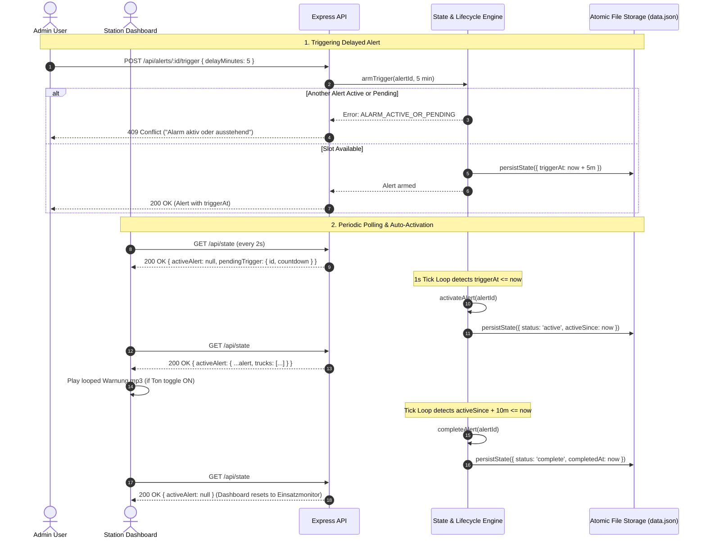

# feat: Firealarm Simulator Web Application

## Overview

Build the complete Firealarm Simulator web application: a Node.js + Express backend with atomic JSON file persistence and a tick-based lifecycle engine, coupled with a React SPA built with Material UI (MUI). The application provides a public station dashboard ("Einsatzmonitor") with responsive truck cards and audio playback, alongside an authenticated administrative panel for truck management, planned alert CRUD, delayed countdown triggers (3–15 minutes), one-shot false alarm drills, and sound duration configuration — strictly enforcing single-active-alarm semantics across the system.

## Problem Frame

Conducting fire station drills requires a realistic, remote-triggerable alarm experience. Manually announcing drills, timing countdowns, flipping monitor displays, and halting audio playback is error-prone and not repeatable. A self-service simulator with strict single-active-alarm invariants, automatic 10-minute reset, and restart-resilient timers enables unattended, repeatable drills across both desktop and mobile browser displays (see origin: `docs/brainstorms/2026-10-17-firealarm-simulator-requirements.md` and authoritative spec `docs/PRD.md`).

## Requirements Trace

- **R1 / R1a**: Responsive layout for desktop and mobile browsers; keyboard accessible with focus management and screen reader live announcements for state and truck highlight changes.
- **R2**: UI text in German (e.g., `Einsatzmonitor`, `Fehlalarm`, `ausstehend`, `aktiv`, `abgeschlossen`); source code and comments in English.
- **R3 / R17a**: State and timers persist across server restarts (derived from persisted epoch timestamps `triggerAt`, `activeSince` via periodic tick loop).
- **D1 / D2**: Single shared instance org-wide; admin credentials configured via environment variables (`BFT_USER` / `BFT_PASS`), never committed to source.
- **R4**: HTTP Basic authentication on all admin endpoints (`/api/trucks*`, `/api/alerts*`, `/api/false-alert`, `/api/settings`); public dashboard and `/api/state` endpoint unauthenticated.
- **R5 / R6**: Truck management (create, modify, delete with name and seats; seeded with 5 trucks). Deleting a truck silently cleans up references in alert `truckIds` without disrupting active alerts.
- **R7 / R8**: Planned alert CRUD with required fields (name, category, address, info), optional notes, and truck multi-select; statuses `pending`, `active`, `complete`.
- **R9 / R9b / R9c / R9d**: Arm delayed triggers (3–15 min integer slider) with live countdown badge (`HH:MM:SS`), cancel button with confirmation toast, persistent admin navigation, and empty selection state.
- **R10 / R16 / R16a**: Strict single-alarm invariant — only one alert may be active or pending delayed trigger system-wide. Second trigger attempts and false alarm attempts while active/pending are rejected with toast ("Alarm aktiv oder ausstehend").
- **R11 / R12 / R13**: Trigger firing transitions alert to active, switches dashboard view, and starts looped alarm sound; auto-completes after 10 minutes or upon manual admin completion ("Abschließen").
- **R14**: Deleting an alert with a pending trigger cancels that trigger immediately.
- **R15**: Trigger one-shot false alarm ("Fehlalarm") with no trucks highlighted; clears after 10 minutes, not persisted in `data.json`.
- **R17 / R18**: Looped `Warnung.mp3` playback for configurable duration (`soundDurationSec`, default 60s); plays in Admin browser on trigger gesture and on dashboard devices with per-device "Ton" toggle (`localStorage`, default off).
- **R19 / R20**: Public dashboard displays idle banner ("Einsatzmonitor") with unhighlighted truck cards when no alert is active; displays active alert details (or "Fehlalarm") with highlighted participating trucks when active.
- **AE1–AE7**: Acceptance examples covering trigger rejection, cancellation, audio playback, 10-minute auto-completion, cascading truck deletion, sound toggle persistence, and restart survivability.

## Scope Boundaries

- Multi-tenancy or multiple user roles beyond the single admin.
- Persistent historical logging or drill analytics.
- Runtime credential mutation (env vars only).
- Truck attributes beyond name and seat count.
- Confirmation dialogs for cascading truck deletion (by design, deletion is silent).

### Deferred to Separate Tasks

- Future hardware siren / GPIO relays or external webhook notifications.
- Audio recording / custom sound upload interface.

## Context & Research

### Relevant Code and Patterns

- **Pre-implementation workspace**: Repository is greenfield.
- **Specification baseline**: `docs/PRD.md` (authoritative technical specification) and `docs/brainstorms/2026-10-17-firealarm-simulator-requirements.md` (requirements baseline).
- **Audio Asset**: `docs/Warnung.mp3` to be copied to `public/sound/` during Vite build.
- **Atomic File Writing Pattern**: `fs.promises.writeFile(tmpPath)` followed by `fs.promises.rename(tmpPath, targetPath)` to prevent half-written state on crash.
- **Periodic Tick Engine**: Server-side `setInterval` (1000ms) that evaluates pure lifecycle transitions and saves state only on mutations.

### Institutional Learnings

- `docs/architecture.md`: Established system architecture, component boundaries, data models, state machines, and directory layout.

### External References

- **Node.js & Express**: Strict TypeScript configuration with ESM or CommonJS bundle compatibility.
- **React 18 / 19 + MUI (Material-UI v5/v6)**: Dark theme palette with fire-station high-contrast accents (`#d32f2f`, `#2e7d32`, `#ed6c02`).
- **Web Audio / HTML5 Audio**: Autoplay policy handling with explicit user gesture unlocks and `localStorage` preference persistence.

## Key Technical Decisions

- **Single Process Architecture**: Express serves both the REST API and the built static React SPA from a single port (`PORT`, default 3000), eliminating CORS issues in production while supporting Vite proxying in development.
- **Pure State Transition Engine**: Decouple domain logic from Express route handlers into a pure, synchronously or deterministically testable `StateEngine`. The tick loop drives time-based transitions (`triggerAt <= now`, `activeSince + 10m <= now`).
- **Atomic JSON Storage (`data.json`)**: Sole writer is the backend process. File writes use a temporary file rename pattern (`data.json.tmp.<pid>.<time>` $\to$ `data.json`). Seeding occurs automatically on server bootstrap if `data.json` does not exist.
- **False Alarm Ephemerality**: In accordance with PRD §8 and R15, false alarms are tracked in-memory by the `StateEngine` with `activeSince` and auto-cleared after 10 minutes. They occupy the active alarm slot for the duration without creating records in `data.json`.
- **Client Polling over WebSockets**: Public dashboard polls `GET /api/state` every 2 seconds. This ensures lightweight, reconnection-free resilience across unreliable fire station Wi-Fi / tablet displays.
- **Audio Playback Strategy**: HTML5 `Audio` element with `loop = true` and a `setTimeout` matching `soundDurationSec`. Dashboard requires explicit user click on the persistent "Ton" toggle to unlock audio context and store preference in `localStorage`.

## Open Questions

### Resolved During Planning

- **Q: How are false alarm countdowns handled across restarts?**
  *Resolution:* False alarms are explicitly one-shot drill tools and not persisted in `data.json` (PRD §8). If the server restarts during a false alarm, the system safely returns to idle state. All planned alerts persist `triggerAt` and `activeSince` in `data.json` and survive restarts completely (R3, R17a).
- **Q: How does the client handle Basic Auth credentials without annoying browser native dialogs?**
  *Resolution:* Admin client stores Base64-encoded credentials in memory/sessionStorage upon successful login form submission and includes the `Authorization: Basic ...` header in API requests via an Axios/fetch wrapper.
- **Q: What is the exact MUI theme token palette for dark mode and high-contrast alert displays?**
  *Resolution:* Standard fire service theme tokens:
  - Dark mode background: `#121212` (Surface / Paper: `#1e1e1e`)
  - Emergency / Active Alert Accent: `#d32f2f` (Fire Red with `#ffffff` text)
  - Highlighted Truck Card Background: `#d32f2f` (with high-contrast white badges)
  - Unhighlighted Truck Card Background: `#2c2c2c` (with subtle neutral border)
  - Warning / Countdown Accent: `#ed6c02` (Amber)
  - Success / Complete Status Accent: `#2e7d32` (Green)

### Deferred to Implementation

- None (all planning-level architecture, contracts, and theme tokens are resolved).

## Output Structure

```
.
├── package.json
├── tsconfig.json
├── tsconfig.server.json
├── tsconfig.client.json
├── vite.config.ts
├── vitest.config.ts
├── index.html
├── src/
│   ├── shared/
│   │   ├── types.ts
│   │   └── constants.ts
│   ├── server/
│   │   ├── index.ts
│   │   ├── storage.ts
│   │   ├── engine.ts
│   │   ├── middleware/
│   │   │   └── auth.ts
│   │   └── routes/
│   │       ├── state.ts
│   │       ├── trucks.ts
│   │       ├── alerts.ts
│   │       ├── falseAlert.ts
│   │       └── settings.ts
│   └── client/
│       ├── main.tsx
│       ├── App.tsx
│       ├── theme.ts
│       ├── api/
│       │   └── client.ts
│       ├── hooks/
│       │   ├── useAppState.ts
│       │   └── useAlarmSound.ts
│       └── components/
│           ├── common/
│           │   ├── Header.tsx
│           │   ├── ToastContainer.tsx
│           │   └── ConfirmDialog.tsx
│           ├── dashboard/
│           │   ├── Dashboard.tsx
│           │   ├── TruckGrid.tsx
│           │   ├── TruckCard.tsx
│           │   └── SoundToggle.tsx
│           └── admin/
│               ├── AdminLayout.tsx
│               ├── TruckManager.tsx
│               ├── AlertManager.tsx
│               ├── AlertFormDialog.tsx
│               ├── TriggerDialog.tsx
│               ├── CountdownBadge.tsx
│               └── SettingsCard.tsx
├── public/
│   └── sound/
│       └── Warnung.mp3
└── tests/
    ├── unit/
    │   ├── storage.test.ts
    │   ├── engine.test.ts
    │   └── auth.test.ts
    └── integration/
        └── api.test.ts
```

## High-Level Technical Design

> *This illustrates the intended approach and is directional guidance for review, not implementation specification. The implementing agent should treat it as context, not code to reproduce.*



### Alert State Decision Matrix

| Current Alert Status | Target Action | Precondition | Outcome |
|---|---|---|---|
| `pending` or `complete` | Arm Trigger (3–15 min) | No active alert & no pending trigger | Sets `triggerAt = now + delay`, returns armed alert |
| `pending` or `complete` | Arm Trigger (3–15 min) | Another alert `active` or has `triggerAt` | Rejects with 409 ("Alarm aktiv oder ausstehend") |
| Any | Trigger False Alarm | No active alert & no pending trigger | Sets in-memory false alert active for 10 min |
| Any | Trigger False Alarm | Another alert `active` or has `triggerAt` | Rejects with 409 ("Alarm aktiv oder ausstehend") |
| Armed (`triggerAt` set) | Cancel Trigger | Alert owns the pending trigger | Clears `triggerAt`, status reverts to `pending`/`complete` |
| `active` (`activeSince` set)| Complete Alert | Manual Admin action | Sets status `complete`, records `completedAt`, clears `activeSince` |
| `active` (`activeSince` set)| Tick Loop (10 min elapsed) | Automatic timeout | Sets status `complete`, records `completedAt`, clears `activeSince` |
| Any | Delete Truck | Truck is referenced in alert `truckIds` | Silently removes truck ID from all alerts without warning |

---

## Implementation Units

- [x] **Unit 1: Project Scaffolding, TypeScript Configuration, Core Domain Types & Atomic Storage**

**Goal:** Establish the TypeScript project configuration, dependency definitions, shared domain interfaces, default seed data, and atomic JSON persistence layer.

**Requirements:** R2, R3, R5, R7, R11, R17, PRD §1, §2, §11, §13.

**Dependencies:** None.

**Files:**
- Create: `package.json`
- Create: `tsconfig.json`
- Create: `tsconfig.server.json`
- Create: `tsconfig.client.json`
- Create: `vite.config.ts`
- Create: `vitest.config.ts`
- Create: `src/shared/types.ts`
- Create: `src/shared/constants.ts`
- Create: `src/server/storage.ts`
- Test: `tests/unit/storage.test.ts`

**Approach:**
- Define `Truck`, `Alert`, `Settings`, `DataFile`, and API payload types in `src/shared/types.ts`.
- Include `ulid` (or `ulidx`) dependency for generating short server-side ULIDs for Truck and Alert entities (PRD §2).
- Include `concurrently` and `tsx` in `devDependencies` to support seamless development orchestration.
- Configure `vite.config.ts` with server proxy mapping `/api` requests to `http://localhost:3000`.
- Implement `storage.ts` with `loadData()` and `saveData()` using `data.json` atomic file writes (`fs.promises.writeFile` to `.tmp` file + `fs.promises.rename`).
- Automatically seed `data.json` on first run if missing with 5 trucks (`ELF 1`, `HLF 20`, `LF 10`, `TLF 16`, `DLK 23`), 2 pending alerts (`Wohnungsbrand`, `THL B3`), and `soundDurationSec: 60`.
- Configure `package.json` scripts:
  - `"dev"`: `concurrently "tsx watch src/server/index.ts" "vite"`
  - `"build"`: `vite build && tsc -p tsconfig.server.json && node -e "fs.cpSync('docs/Warnung.mp3', 'dist/client/sound/Warnung.mp3', {recursive:true, force:true})"`
  - `"start"`: `node dist/server/index.js`
  - `"test"`: `vitest run`

**Patterns to follow:**
- Pure typed serialization and file system locks/atomic renames.

**Test scenarios:**
- Happy path: `storage.loadData()` creates and seeds `data.json` when the file does not exist, returning 5 trucks, 2 alerts, and default settings.
- Happy path: `storage.saveData()` writes new alerts/trucks atomically and subsequent `loadData()` reads the modified state.
- Edge case: Multiple rapid sequential `saveData()` calls execute without file locking corruption or partial writes.
- Error path: Invalid JSON in `data.json` raises a descriptive error rather than silently overwriting data.

**Verification:**
- `npm test -- tests/unit/storage.test.ts` passes with 100% success.

---

- [x] **Unit 2: Alert Lifecycle Engine, Timer Tick Loop & Pure Domain Logic**

**Goal:** Implement the pure domain state machine and tick loop that handles trigger arming, cancellation, single-alarm enforcement, auto-activation, 10-minute auto-completion, false alarm drills, and cascading truck deletion.

**Requirements:** R3, R5, R6, R7, R8, R9, R10, R11, R12, R13, R14, R15, R16, R16a, R17a, AE1–AE5, AE7, PRD §2, §5, §6, §7, §8, §14.

**Dependencies:** Unit 1.

**Files:**
- Create: `src/server/engine.ts`
- Test: `tests/unit/engine.test.ts`

**Approach:**
- Create `StateEngine` class encapsulating `DataFile` state and in-memory false alarm state.
- Implement methods:
  - `armTrigger(alertId, delayMinutes)`: validates 3–15 min, checks single-alarm invariant (throws if another alert is active or pending), sets `triggerAt`.
  - `cancelTrigger(alertId)`: clears `triggerAt` and returns alert to previous status.
  - `tick(nowEpoch)`: evaluates pending alerts (`triggerAt <= now` $\to$ active with `activeSince = now`), evaluates active alerts (`activeSince + 10m <= now` $\to$ complete with `completedAt = now`), evaluates false alarms (`activeSince + 10m <= now` $\to$ cleared).
  - `completeAlert(alertId)`: manually completes active alert.
  - `triggerFalseAlert()`: checks single-alarm invariant, sets false alarm `activeSince = now`.
  - `deleteTruck(truckId)`: removes truck and strips `truckId` from all alert `truckIds`.
  - `deleteAlert(alertId)`: deletes alert; if it had an armed trigger, cancels it automatically.
  - `getState(nowEpoch)`: returns public dashboard state payload (`activeAlert`, `falseAlarmActive`, `trucks`, `settings`, `pendingTrigger`).

**Execution note:**
- Implement domain state transitions test-first against all acceptance criteria (AE1–AE7).

**Patterns to follow:**
- Pure domain model state transitions with deterministic clock injection (`now` timestamp parameter).

**Test scenarios:**
- Happy path (AE2, R9): Arming a trigger with 5-minute delay sets `triggerAt = now + 300,000` ms; canceling returns alert to un-armed status.
- Happy path (AE3, R11): Calling `tick(now >= triggerAt)` activates the alert and sets `activeSince = now`.
- Happy path (AE4, R12): Calling `tick(now >= activeSince + 10 min)` marks the active alert as `complete`.
- Happy path (R13): Calling `completeAlert()` manually transitions an active alert to `complete` immediately.
- Happy path (R15): Triggering a false alarm sets false alarm active; auto-clears after 10 minutes in `tick()`.
- Happy path (R8): A completed alert can be re-triggered for repeat drills.
- Edge case (AE5, R6): Deleting a truck removes it from the truck list and strips its ID from all alerts (including currently active alerts).
- Edge case (R14): Deleting an alert with an armed trigger cancels the trigger and unblocks the one-alarm slot.
- Edge case (AE7, R3): Re-instantiating `StateEngine` with persisted timestamps resumes countdowns and active timeouts accurately.
- Error path (AE1, R10): Arming a trigger when another alert has `triggerAt` or is `active` throws `ALARM_ACTIVE_OR_PENDING`.
- Error path (R16, R16a): Triggering a false alarm while an alert is active or pending (or while another false alarm is active) throws `ALARM_ACTIVE_OR_PENDING`.
- Error path: Arming a trigger with delay < 3 min or > 15 min throws validation error.

**Verification:**
- `npm test -- tests/unit/engine.test.ts` passes with all lifecycle and invariant tests green.

---

- [x] **Unit 3: Express Backend API & Basic Authentication**

**Goal:** Create Express server routes, Basic Auth middleware (`BFT_USER` / `BFT_PASS`), JSON request validation, periodic tick runner, and wire up public and admin endpoints.

**Requirements:** R4, D2, R5, R7, R9, R10, R12, R13, R15, R16, R17, PRD §1, §3, §10.

**Dependencies:** Unit 1, Unit 2.

**Files:**
- Create: `src/server/middleware/auth.ts`
- Create: `src/server/routes/state.ts`
- Create: `src/server/routes/trucks.ts`
- Create: `src/server/routes/alerts.ts`
- Create: `src/server/routes/falseAlert.ts`
- Create: `src/server/routes/settings.ts`
- Create: `src/server/index.ts`
- Test: `tests/unit/auth.test.ts`
- Test: `tests/integration/api.test.ts`

**Approach:**
- `auth.ts`: Middleware checking `Authorization: Basic ...` against `process.env.BFT_USER || 'ffw_bft'` and `process.env.BFT_PASS || 'bft_2026'`. Returns 401 with `WWW-Authenticate: Basic realm="Firealarm Simulator Admin"` on failure.
- `state.ts`: Public `GET /api/state` endpoint returning current state without authentication.
- Mount protected routes behind `auth.ts`:
  - `GET/POST /api/trucks`, `PATCH/DELETE /api/trucks/:id`
  - `GET/POST /api/alerts`, `PATCH/DELETE /api/alerts/:id`
  - `POST /api/alerts/:id/trigger` (`{ delayMinutes }`)
  - `POST /api/alerts/:id/cancel-trigger`
  - `POST /api/alerts/:id/complete`
  - `POST /api/false-alert`
  - `PATCH /api/settings` (`{ soundDurationSec }`)
- `index.ts`: Bootstraps Express, loads storage, initializes `StateEngine`, starts `setInterval(() => engine.tick(Date.now()), 1000)`, serves static Vite client assets, handles catch-all route `*` $\to$ `index.html`.

**Patterns to follow:**
- Express modular routers, centralized error handling, HTTP status codes (200, 201, 400, 401, 404, 409).

**Test scenarios:**
- Happy path: `GET /api/state` returns 200 OK without credentials.
- Happy path: `GET /api/trucks` with valid Basic Auth header returns 200 OK and truck list.
- Happy path: `POST /api/alerts/:id/trigger` with `{ delayMinutes: 5 }` returns 200 OK.
- Error path: Accessing `POST /api/trucks` without auth header or with invalid credentials returns 401 Unauthorized.
- Error path: `POST /api/alerts/:id/trigger` when another alert is active returns 409 Conflict with message "Alarm aktiv oder ausstehend".
- Error path: `POST /api/false-alert` when an alert is active returns 409 Conflict.
- Integration scenario: Creating a truck, creating an alert with that truck, triggering the alert, querying `/api/state`, and completing the alert succeeds through HTTP API.

**Verification:**
- `npm test -- tests/unit/auth.test.ts tests/integration/api.test.ts` passes.

---

- [x] **Unit 4: Public Station Dashboard & Audio Engine (React + MUI)**

**Goal:** Build the responsive public dashboard view ("Einsatzmonitor") with 2-second polling, responsive truck card grid, active alert banners, screen reader accessibility, and looped audio playback with per-device "Ton" toggle.

**Requirements:** R1, R1a, R2, R17, R18, R19, R20, AE3, AE6, PRD §4, §9, §12.

**Dependencies:** Unit 1, Unit 3.

**Files:**
- Create: `src/client/theme.ts`
- Create: `src/client/hooks/useAppState.ts`
- Create: `src/client/hooks/useAlarmSound.ts`
- Create: `src/client/components/dashboard/TruckCard.tsx`
- Create: `src/client/components/dashboard/TruckGrid.tsx`
- Create: `src/client/components/dashboard/SoundToggle.tsx`
- Create: `src/client/components/dashboard/Dashboard.tsx`
- Modify: `src/client/App.tsx`

**Approach:**
- `theme.ts`: MUI dark fire station theme with high contrast (`#121212` background, `#d32f2f` emergency alert red, `#2c2c2c` idle truck card), responsive typography, and distinct highlight colors for participating trucks.
- `useAppState.ts`: Polling hook requesting `GET /api/state` every 2000ms with error recovery and live state sync.
- `useAlarmSound.ts`: Audio management hook loading `/sound/Warnung.mp3` (served directly from `public/sound/` in dev and `dist/client/sound/` in prod). Listens for active alert transitions; if `soundEnabled` (stored in `localStorage`) is true, loops audio for `soundDurationSec` seconds and then stops.
- `Dashboard.tsx`:
  - When idle: Renders prominent "Einsatzmonitor" headline, unhighlighted responsive truck grid (`xs=12, sm=6, md=4`).
  - When active alert: Top half renders alert Category, Address, Info, and optional Notes; lower half renders truck grid with participating trucks highlighted (accent background).
  - When false alarm: Top half renders "Fehlalarm" banner; truck grid rendered unhighlighted.
  - Top right: Persistent "Ton" toggle button (R18).
  - Accessibility (R1a): ARIA live regions announcing alert changes, semantic markup, full keyboard navigation.

**Patterns to follow:**
- React hooks for state and audio management, MUI Grid2 / Grid responsive breakpoints, `localStorage` synchronization.

**Test scenarios:**
- Happy path: Dashboard renders "Einsatzmonitor" and 5 unhighlighted truck cards when state has no active alert.
- Happy path: Dashboard switches to show alert category, address, and highlights participating trucks when state has an active alert.
- Happy path: Dashboard shows "Fehlalarm" banner with unhighlighted trucks when `falseAlarmActive` is true.
- Edge case (AE6, R18): Audio playback triggers on transition to active only when "Ton" toggle is enabled; stays silent when toggle is off.
- Integration: Toggling "Ton" persists preference in `localStorage` and remains consistent across page reloads.

**Verification:**
- Client components render cleanly in Vite dev server and pass DOM/component test assertions.

---

- [x] **Unit 5: Admin Panel (Truck CRUD, Alert CRUD, Delayed Trigger Dialog & Controls)**

**Goal:** Build the authenticated Admin interface in German with truck management, planned alert CRUD, delayed trigger slider dialog (3–15 min), live countdown badges with cancel action, manual completion, one-shot false alarm trigger, and sound settings.

**Requirements:** R1, R1a, R2, R4, R5, R7, R8, R9, R9b, R9c, R9d, R10, R13, R15, R16, R17, AE1, AE2, PRD §5, §6, §7, §8, §9, §12.

**Dependencies:** Unit 3, Unit 4.

**Files:**
- Create: `src/client/api/client.ts`
- Create: `src/client/components/common/Header.tsx`
- Create: `src/client/components/common/ToastContainer.tsx`
- Create: `src/client/components/common/ConfirmDialog.tsx`
- Create: `src/client/components/admin/AdminLayout.tsx`
- Create: `src/client/components/admin/TruckManager.tsx`
- Create: `src/client/components/admin/AlertManager.tsx`
- Create: `src/client/components/admin/AlertFormDialog.tsx`
- Create: `src/client/components/admin/TriggerDialog.tsx`
- Create: `src/client/components/admin/CountdownBadge.tsx`
- Create: `src/client/components/admin/SettingsCard.tsx`
- Modify: `src/client/App.tsx`

**Approach:**
- `client.ts`: Axios/Fetch wrapper managing Basic Auth headers, storing credentials in memory/sessionStorage, handling 401s and 409 conflict toasts.
- `AdminLayout.tsx`: Header navigation between Dashboard and Admin tabs, credentials entry modal if unauthenticated, quick "Fehlalarm auslösen" button with confirmation.
- `TruckManager.tsx`: List existing trucks, dialog for Add/Edit truck (Name, Seats), delete truck button.
- `AlertManager.tsx`:
  - List planned alerts with Name, Category, Address, Trucks, Status (`ausstehend`, `aktiv`, `abgeschlossen`).
  - Row actions:
    - Status `pending` or `complete`: **Auslösen** (Trigger) button.
    - Countdown active: Live countdown badge (`HH:MM:SS`) + **Abbrechen** (Cancel) button.
    - Status `active`: **Abschließen** (Complete) button.
    - Edit and Delete action icons.
  - Empty state (R9d): "Keine ausstehenden Alarme — neuen Alarm anlegen?".
- `TriggerDialog.tsx`: Dialog with integer slider from 3 to 15 minutes, default 3 min, confirm button.
- `SettingsCard.tsx`: Numeric input for `soundDurationSec` with save button.
- Toasts: German feedback for trigger rejections ("Alarm aktiv oder ausstehend"), cancellations ("Trigger abgebrochen"), and saves.

**Patterns to follow:**
- Controlled MUI form dialogs, toast notifications, responsive action toolbars.

**Test scenarios:**
- Happy path: Admin can create a new alert with required fields and truck selection; alert appears in list with status `ausstehend`.
- Happy path: Trigger dialog allows selecting delay between 3 and 15 minutes; on confirm, row displays live countdown and cancel button.
- Happy path: Clicking cancel on an armed row cancels trigger and displays confirmation toast.
- Happy path: Clicking "Abschließen" on an active alert completes the alert immediately.
- Happy path: Clicking "Fehlalarm auslösen" triggers false alarm and switches system state.
- Error path (AE1, R10): Triggering an alert while another is active or armed displays toast "Alarm aktiv oder ausstehend".
- Error path: Validation prevents submitting alert form when Name, Category, Address, or Info are empty.

**Verification:**
- Admin flows function seamlessly in client UI, communicating with backend REST endpoints with proper auth headers and error handling.

---

- [x] **Unit 6: Production Build, Audio Asset Pipeline, End-to-End Verification & Documentation**

**Goal:** Wire the build pipeline (Vite build, copying `Warnung.mp3` to production public assets), verify single-port production serving, execute full test suite with ≥80% coverage, and validate compliance against all PRD requirements.

**Requirements:** R1, R2, R3, R17, PRD §1, §9, §13, §14.

**Dependencies:** Unit 1, Unit 2, Unit 3, Unit 4, Unit 5.

**Files:**
- Create: `public/sound/Warnung.mp3` (copied from `docs/Warnung.mp3`)
- Modify: `package.json` (build scripts)
- Modify: `vite.config.ts`
- Create: `tests/integration/lifecycle.e2e.test.ts`
- Update: `docs/architecture.md`

**Approach:**
- Configure `package.json` build script: `vite build` builds React SPA to `dist/client`, `tsc -p tsconfig.server.json` builds server to `dist/server`, and asset script copies `docs/Warnung.mp3` to `dist/client/sound/Warnung.mp3` (ensuring `/sound/Warnung.mp3` is available at runtime).
- Verify production server serves API routes on `/api/*` and static files on `/*` with SPA fallback.
- Verify development workflow: `npm run dev` launches Express on port 3000 via `tsx watch` and Vite on port 5173 with proxy for `/api` concurrently.
- Run complete test suite covering unit tests and API integration tests.
- Confirm maintainability and test coverage ≥80%.

**Patterns to follow:**
- Standard Node.js build pipeline and Vitest test runner with timeout protections.

**Test scenarios:**
- Integration scenario: Full end-to-end drill flow: create alert -> arm 3 min trigger -> simulate tick to fire -> active alert verified on `/api/state` -> simulate tick to 10 min -> alert auto-completed.
- Integration scenario: Production build executes `npm run build && npm test` cleanly without type errors or broken asset paths.

**Verification:**
- `npm run build` succeeds, `npm test` runs with 100% pass rate and ≥80% coverage.

---

## Progress Checklist

Tracking the Compound Engineering cycle for Firealarm Simulator:

- [x] **Phase 0: Problem Framing & Scope Definition** (Completed in `docs/brainstorms/2026-10-17-firealarm-simulator-requirements.md` & `docs/PRD.md`)
- [x] **Phase 1: Architecture Design & System Specification** (Completed in `docs/architecture.md`)
- [x] **Phase 2: Implementation Planning** (Completed in `docs/plans/2026-10-18-001-feat-firealarm-simulator-web-app-plan.md`)
- [x] **Phase 3: Execution (ce-work)**
  - [x] Unit 1: Project Scaffolding, TypeScript Configuration, Core Domain Types & Atomic Storage
  - [x] Unit 2: Alert Lifecycle Engine, Timer Tick Loop & Pure Domain Logic
  - [x] Unit 3: Express Backend API & Basic Authentication
  - [x] Unit 4: Public Station Dashboard & Audio Engine
  - [x] Unit 5: Admin Panel (Truck CRUD, Alert CRUD, Delayed Trigger Dialog & Controls)
  - [x] Unit 6: Production Build, Audio Asset Pipeline, End-to-End Verification & Documentation
- [x] **Phase 4: Code Review & Quality Audit (ce-review)** (Completed — 8 P1, 9 P2, 8 P3 findings resolved; 141/141 tests passing. Skipped: credentials in sessionStorage (#16) and PATCH-on-active-alert (#18) — product decisions deferred.)
- [ ] **Phase 5: Release & Verification**

---

## System-Wide Impact

- **Interaction graph:**
  - Browser Dashboard $\leftrightarrow$ `GET /api/state` polling (2s interval).
  - Admin UI $\leftrightarrow$ Protected REST endpoints with HTTP Basic Auth.
  - Express Server $\leftrightarrow$ `StateEngine` (1s tick loop) $\leftrightarrow$ `Storage` (`data.json` atomic file writes).
- **Error propagation:**
  - Invariant violations (e.g. concurrent triggers) throw typed domain errors mapped by Express to 409 Conflict.
  - Client Axios/Fetch wrapper catches 409 and displays German toast notification.
  - Storage errors log to server console and return 500 without crashing the Express process or corrupting `data.json`.
- **State lifecycle risks:**
  - `data.json` write collisions are eliminated via single-process serial file writes using temporary file rename.
  - Server restarts preserve `triggerAt` and `activeSince` timestamps so countdowns and active timeouts continue seamlessly upon restart.
- **Unchanged invariants:**
  - Dashboard `/api/state` remains public and unauthenticated at all times.
  - Only one alert or false alarm is active/armed system-wide.
  - UI labels remain in German; codebase remains in English.

## Risks & Dependencies

| Risk | Likelihood | Impact | Mitigation |
|---|---|---|---|
| Browser blocks audio autoplay on Dashboard | High | Med | Implement persistent "Ton" toggle in dashboard header with `localStorage` persistence and explicit user gesture unlock (R18). |
| Server crash during JSON write corrupts data file | Low | High | Atomic write strategy: write to `data.json.tmp.<id>` first, then rename over `data.json`. |
| Second drill triggered accidentally during active drill | Med | Med | Strict single-alarm invariant enforced in `StateEngine`, rejecting with 409 toast ("Alarm aktiv oder ausstehend"). |
| Server restarted during delayed countdown | Med | High | Countdown computed from `triggerAt` epoch timestamp persisted in `data.json`, evaluated by tick loop on boot and every second (R3, R17a). |
| Truck deleted while participating in active alert | Med | Low | Cascading cleanup silently removes truck from all alert `truckIds`; dashboard continues showing remaining trucks (R6). |

## Documentation / Operational Notes

- **Configuration:** Set environment variables `BFT_USER` and `BFT_PASS` to override default admin credentials (`ffw_bft` / `bft_2026`). Set `PORT` to override default port `3000`.
- **First Run:** App automatically creates and seeds `data.json` on initial boot if not present.
- **Production Deployment:** Run `npm run build && npm start`. Single port serves both API and static SPA.

## Sources & References

- **Origin document:** [docs/brainstorms/2026-10-17-firealarm-simulator-requirements.md](docs/brainstorms/2026-10-17-firealarm-simulator-requirements.md)
- **Authoritative Technical Spec:** [docs/PRD.md](docs/PRD.md)
- **Architecture Overview:** [docs/architecture.md](docs/architecture.md)
- **Project Guidance:** [AGENTS.md](AGENTS.md)
